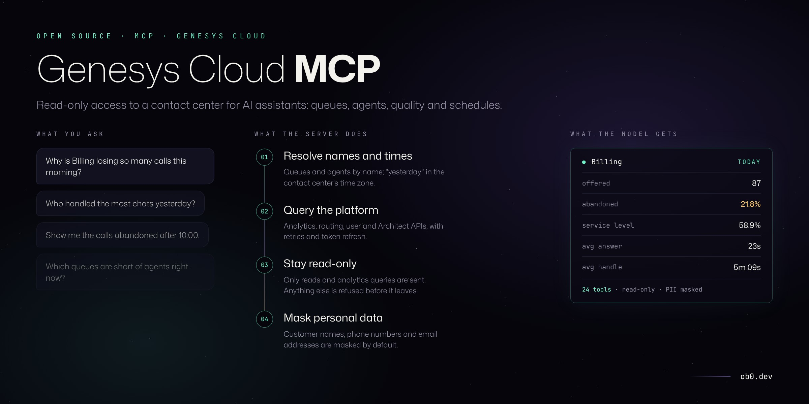

# genesys-cloud-mcp

[](https://github.com/oebh2408/genesys-cloud-mcp/actions/workflows/ci.yml)


Most questions a supervisor asks about a contact center are simple to say and slow to answer: which queue is losing calls this morning, who handled the most chats yesterday, what happened to a specific call. In Genesys Cloud the answer is usually spread over a few analytics views and filters. An AI assistant with access to the Platform API could answer them directly, but giving it a token that can also change routing, or read every customer's phone number, is not something most teams want.

This is a [Model Context Protocol](https://modelcontextprotocol.io) server that gives the assistant 24 tools over queues, agents, conversations, IVR flows, opening hours, quality evaluations, surveys, workforce management schedules, callbacks and outbound campaigns, and nothing that writes. Every request goes through a read-only check before it is sent, and customer names, numbers and email addresses are masked by default. It includes a simulated contact center, so it can be tried in any MCP client without a Genesys Cloud account.


<sub>Four tool calls against the demo contact center, shown as tables by `npm run try`. The model receives the same data as JSON.</sub>

## What you can ask

- How are the queues doing right now? Is anyone waiting?
- Which queue missed its service level yesterday, and in which hours?
- Who handled the most interactions this week and what is their average handle time?
- Show me the abandoned chats from the last 4 hours that waited more than two minutes.
- Walk me through conversation `284d0a28-...`: how long did the customer wait, was there a hold, how did it end?
- Is Billing doing better or worse than last Tuesday at this time?
- How much of the morning were the Billing agents actually on queue, and when did they take lunch?
- What was Karen doing between 10:00 and 11:00?
- How many callers finished in the IVR without talking to anyone, and how many hung up in the menus?
- Are we open on the 2nd of November? When do we close today?
- What wrap-up codes did Retention use this week, and how often did they save the cancellation?
- Who is out of adherence right now, and for how long?
- Were we short of the schedule in Billing yesterday morning, or was the schedule itself too thin?
- What is Emma's average quality score this month, and did she fail any critical questions?
- What did the detractors say about Support this week?
- How many callbacks are waiting, and how long did customers wait to be called back today?
- How far along is the upgrade campaign, and what is its connect rate?

## Tools

Queues

| Tool | What it returns | API used |
| --- | --- | --- |
| `list_queues` | Queues and member counts | `GET /api/v2/routing/queues` |
| `get_queue` | Configuration of one queue: service level target, alerting timeout, after-call work, skill evaluation, wrap-up codes, and its members with skills and current status | `GET /api/v2/routing/queues/{id}`, `.../wrapupcodes`, `.../members` |
| `get_queue_status` | Waiting, longest wait, interacting, agents on queue by routing status | `POST /api/v2/analytics/queues/observations/query` |
| `get_queue_performance` | Offered, answered, abandoned, abandon rate, service level, ASA, handle, talk, hold and ACW averages; optional time buckets | `POST /api/v2/analytics/conversations/aggregates/query` |
| `compare_queue_performance` | The same metrics for two intervals and the change, by default against the same interval a week earlier | `POST /api/v2/analytics/conversations/aggregates/query` |

Agents

| Tool | What it returns | API used |
| --- | --- | --- |
| `list_agents` | Agents with presence and routing status, filtered by queue, status or name | `GET /api/v2/users`, `GET /api/v2/routing/queues/{id}/members` |
| `get_agent` | One agent: queues, skills, languages, current status, and today's interactions and time by status | `GET /api/v2/users/{id}`, `GET /api/v2/users/{id}/queues`, conversation and user aggregates |
| `get_agent_performance` | Handled interactions and average handle, talk, hold and ACW per agent | `POST /api/v2/analytics/conversations/aggregates/query` |
| `get_agent_status_summary` | Minutes logged in, on queue, idle, interacting and off queue by presence (break, meal, meeting...), on-queue share and occupancy, per agent and for the team | `POST /api/v2/analytics/users/aggregates/query` |
| `get_agent_timeline` | Status changes of one agent with durations, and the interactions handled, for up to seven days | `POST /api/v2/analytics/users/details/query`, conversation details |

Conversations

| Tool | What it returns | API used |
| --- | --- | --- |
| `search_conversations` | One line per conversation, filtered by queue, agent, media type, direction, outcome, wait or duration | `POST /api/v2/analytics/conversations/details/query` |
| `get_conversation` | Timeline of one conversation: queue time, talk, hold, after-call work, wrap-up, who disconnected | `GET /api/v2/analytics/conversations/{id}/details` |
| `get_wrapup_summary` | Count, share and average handle time per wrap-up code, for a queue, an agent or the center | `POST /api/v2/analytics/conversations/aggregates/query` |

Flows and opening hours

| Tool | What it returns | API used |
| --- | --- | --- |
| `get_flow_performance` | Per inbound flow (IVR, chat bot): entered, transferred to a queue, ended in the flow, time in the flow and flow outcomes; optional time buckets | `GET /api/v2/flows`, `POST /api/v2/analytics/flows/aggregates/query` |
| `get_schedule_status` | Whether each schedule group is open, closed or on a holiday now or at a given time, which schedule decides it, the next change and the holidays in the next 60 days | `GET /api/v2/architect/schedulegroups`, `GET /api/v2/architect/schedules` |

Quality and surveys

| Tool | What it returns | API used |
| --- | --- | --- |
| `get_quality_summary` | Released evaluations per agent, queue or evaluator: count, average, lowest and highest score, average critical score | `POST /api/v2/analytics/evaluations/aggregates/query` |
| `list_evaluations` | Evaluations newest first with agent, evaluator, form, score, critical score and whether the agent read it; optionally only critical failures | `GET /api/v2/quality/evaluations/query` |
| `get_survey_summary` | Surveys sent and answered, response rate, NPS and average score, per queue or agent | `POST /api/v2/analytics/surveys/aggregates/query` |
| `list_survey_responses` | Answered surveys with the NPS answer, score and comment, filtered to detractors, passives, promoters or answers with comments. Contact details in comments are masked. | Conversation details with `surveyFilters`, `GET /api/v2/quality/conversations/{id}/surveys` |

Workforce management

| Tool | What it returns | API used |
| --- | --- | --- |
| `get_adherence` | For each agent now: scheduled activity, actual activity, adherence state, impact and minutes in that state | `GET /api/v2/workforcemanagement/adherence` |
| `get_agent_schedule` | Published shifts for a day with their activities (on queue, breaks, lunch, meetings, training) in local time | `POST /api/v2/workforcemanagement/managementunits/{id}/agentschedules/search`, activity codes |
| `get_staffing` | For one queue and day, per time bucket: agents scheduled on queue, agents actually on queue, offered, abandoned and service level | Schedules, user details and conversation aggregates |

Callbacks and outbound

| Tool | What it returns | API used |
| --- | --- | --- |
| `get_callbacks` | Callbacks waiting now per queue with the oldest, and callbacks requested and completed in an interval with the time to call back | Queue observations and conversation aggregates for `mediaType` callback |
| `get_campaigns` | Outbound campaigns: status, dialing mode, queue, contact list progress, idle agents, and attempts, connects, connect rate and wrap-up codes in an interval | `GET /api/v2/outbound/campaigns`, `.../{id}/stats`, `.../{id}/progress`, conversation aggregates |

Prompts combine the tools for common tasks:

| Prompt | What it asks for |
| --- | --- |
| `queue_health_report` | Live status and today's hourly trend, with the queues to act on |
| `daily_summary` | A day compared with the same day a week earlier: volumes, service level, abandons, the IVR, callbacks, NPS and wrap-up codes |
| `agent_review` | Notes for a one-to-one: volume, handle time against the team, time on queue, quality scores, survey comments and wrap-up codes |
| `abandon_investigation` | When a queue lost calls, how long callers waited, scheduled against actual agents, callbacks and what the IVR did |

Queues, agents and flows can be given by name; partial names work (`"chat"` finds `Chat Support`). Intervals accept `today`, `yesterday`, `this_week`, `last 30m`, `last 4h`, `last 7d` or an ISO-8601 interval. Calendar words use `GENESYS_TIMEZONE`.

Results are JSON with names instead of ids, durations in seconds (or minutes where the field says so) and rates as percentages, so the model does not have to convert milliseconds or look up ids.

## Try it with the demo contact center

The demo is a fictional center with six queues (voice and chat), 25 agents and three entry flows. Calls arrive on a daily curve, go through the IVR or the chat bot, and are routed to the first free agent who is on shift and not on lunch or a break, so waits, abandons and service level come out of the load and staffing. Some callers finish in self-service or hang up in the menus, and outside opening hours they hear the closed message. In three queues, callers about to hang up can ask for a callback. The opening hours have weekday and weekend schedules, a closed slot for a team meeting and the local holidays.

Agents work published shifts with two breaks and lunch, and do not follow them exactly: some log in late, some breaks run over, and a call that runs into a break delays it. Two supervisors evaluate about one in 25 interactions, about 30% of customers get a survey and a third of them answer, some with a comment. Sales and Retention run outbound campaigns. History covers the last five weeks and live status changes as the day goes on.

In Claude Desktop, add this to `claude_desktop_config.json`:

```json
{
  "mcpServers": {
    "genesys-cloud-demo": {
      "command": "npx",
      "args": ["-y", "github:oebh2408/genesys-cloud-mcp", "--demo"]
    }
  }
}
```

In Claude Code:

```sh
claude mcp add genesys-cloud-demo -- npx -y github:oebh2408/genesys-cloud-mcp --demo
```

Or from a clone:

```sh
npm install
npm run try                 # calls three tools and prints the results as tables
npm run inspector           # opens the MCP Inspector against the demo
```

This is what the model receives from `get_queue_performance` for the demo Billing queue on a bad morning:

```json
{
  "interval": "2026-10-20T05:00:00.000Z/2026-10-20T16:40:00.000Z",
  "timeZone": "America/Bogota",
  "serviceLevelTargetSeconds": 20,
  "queues": [
    {
      "queue": "Billing",
      "offered": 87,
      "answered": 60,
      "abandoned": 19,
      "abandonRatePercent": 21.8,
      "serviceLevelPercent": 58.9,
      "avgSpeedOfAnswerSeconds": 23,
      "longestWaitSeconds": 254,
      "avgAbandonSeconds": 67,
      "avgHandleSeconds": 309,
      "avgTalkSeconds": 250,
      "avgHoldSeconds": 67,
      "avgAcwSeconds": 35,
      "transferred": 1,
      "leftForCallback": 8
    }
  ]
}
```

## Connect to a real org

1. In Genesys Cloud, create a role with view permissions only. The tools need:
   - `analytics:conversationAggregate:view`
   - `analytics:conversationDetail:view`
   - `analytics:queueObservation:view`
   - `analytics:userAggregate:view`
   - `analytics:userDetail:view`
   - `analytics:flowAggregate:view`
   - `routing:queue:view`
   - `routing:wrapupCode:view`
   - `routing:skill:view`
   - `architect:flow:view`
   - `architect:schedule:view`
   - `architect:scheduleGroup:view`
   - `analytics:evaluationAggregate:view`, `quality:evaluation:view`
   - `analytics:surveyAggregate:view`, `quality:survey:view`
   - `wfm:realtimeAdherence:view`, `wfm:schedule:view`, `wfm:agent:view`, `wfm:activityCode:view`
   - `outbound:campaign:view`
   - permission to view users, their presence and routing status

   Permission names change from time to time; check them in Admin > Roles / Permissions. A 403 from a tool tells you which request was refused.
2. Create an OAuth client with the **Client Credentials** grant and assign it that role, restricted to the divisions you want the assistant to see.
3. Configure the server:

```json
{
  "mcpServers": {
    "genesys-cloud": {
      "command": "npx",
      "args": ["-y", "github:oebh2408/genesys-cloud-mcp"],
      "env": {
        "GENESYS_CLIENT_ID": "...",
        "GENESYS_CLIENT_SECRET": "...",
        "GENESYS_REGION": "mypurecloud.com",
        "GENESYS_TIMEZONE": "America/Bogota"
      }
    }
  }
}
```

| Variable | Default | Description |
| --- | --- | --- |
| `GENESYS_CLIENT_ID` | | OAuth client id |
| `GENESYS_CLIENT_SECRET` | | OAuth client secret |
| `GENESYS_REGION` | | Region domain: `mypurecloud.com`, `usw2.pure.cloud`, `mypurecloud.ie`, `mypurecloud.de`, `mypurecloud.com.au`, ... |
| `GENESYS_TIMEZONE` | `UTC` (demo: `America/Bogota`) | IANA time zone for `today`, `yesterday` and `this_week` |
| `GENESYS_REDACT` | `true` | Mask customer phone numbers, emails and names |
| `GENESYS_DEMO` | `false` | Same as `--demo` |

## Safety

| Concern | Handling |
| --- | --- |
| The assistant changes something in the org | Every request goes through one check that allows `GET`, the analytics query endpoints and the schedule search, and refuses anything else before it is sent. The OAuth role, with view permissions only, is the second layer. |
| Customer data reaches the model | Masked by default: phone numbers keep the last four digits (`+1•••4567`), emails keep the first letter and the domain, customer names become initials. Agent names are shown. `GENESYS_REDACT=false` turns it off. |
| Credentials leak | They are read from the environment and are not logged or returned in tool results. |
| Rate limits | 429 and 5xx responses are retried with `Retry-After` or exponential backoff, up to three times. An expired token is refreshed once. |

## Library

The server can be embedded, for example to run it over a different transport or to point it at another implementation of the API:

```ts
import { createServer, HttpPlatformClient } from 'genesys-cloud-mcp';
import { StdioServerTransport } from '@modelcontextprotocol/sdk/server/stdio.js';

const client = new HttpPlatformClient({ clientId, clientSecret, region: 'mypurecloud.com' });
const server = createServer({ client, timeZone: 'America/Bogota' });
await server.connect(new StdioServerTransport());
```

`PlatformClient` is a single `request(method, path, options)` method. `DemoPlatformClient` implements it with the simulated center, which is also what the tests use.

## Limits

- Directory lookups (queues, users, wrap-up codes, flows) read up to 2,000 entries each and are cached for five minutes.
- `search_conversations` returns at most 100 conversations per call and uses the synchronous details query, which Genesys Cloud limits to recent intervals. Large exports belong in an analytics job, not in a chat.
- Service level is reported as computed by Genesys Cloud for each queue; the 20 second target shown in results is the demo's setting.
- Queue observations are per queue. An agent who is a member of several queues is counted in each.
- `get_agent_timeline` reads up to 100 interactions per call and covers at most seven days.
- `get_schedule_status` evaluates schedules itself. It understands one-off schedules and RRULEs with `FREQ` daily, weekly (`BYDAY`), monthly (`BYMONTHDAY`) or yearly, `INTERVAL` and `UNTIL`; other rule parts are ignored. The next change is found to the minute within eight days.
- `get_adherence` is real time only. Historical adherence in Genesys Cloud is an asynchronous report and is not covered.
- Schedule searches that Genesys Cloud answers asynchronously (large management units or long periods) are not supported yet; the tool says so instead of guessing.
- `list_survey_responses` reads the newest 100 conversations with an answered survey and then each survey for its comment, so it is meant for recent samples, not exports.
- The quality, survey, workforce management and outbound tools follow the Platform API documentation and are tested against the demo org, which implements the same requests. Field names in a real org can differ in details; please open an issue if one does.
- `endedInFlow` in `get_flow_performance` does not separate self-service from callers who hung up; flow outcomes do, if the flows set them.

## Design decisions

- [0001 · Read-only tools only](docs/adr/0001-read-only-tools.md)
- [0002 · Demo org behind the same client interface](docs/adr/0002-demo-org-behind-the-same-interface.md)
- [0003 · Shape results for the model, not the API](docs/adr/0003-shape-results-for-the-model.md)

## Development

```bash
npm install
npm test         # tools against the demo org, the read-only check, masking, and the server over stdio
npm run try -- get_queue_status '{"queues":["Support"]}'   # one tool, raw JSON
npm run demo:svg # re-renders docs/demo.svg from npm run try, with the clock pinned
```

## License

MIT © [Oscar Benavides](https://ob0.dev)

Not affiliated with or endorsed by Genesys. Genesys Cloud is a trademark of its owner.
